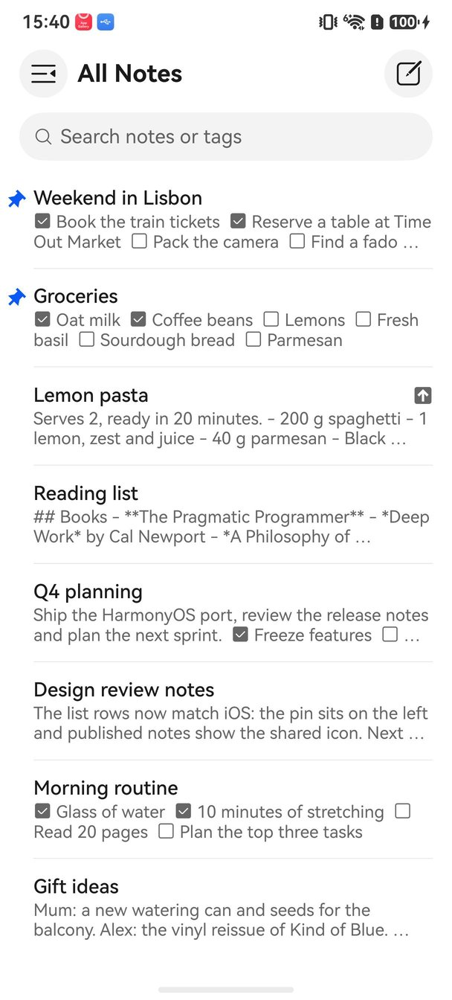
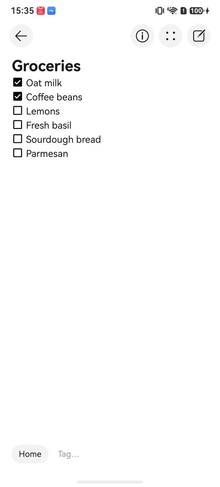
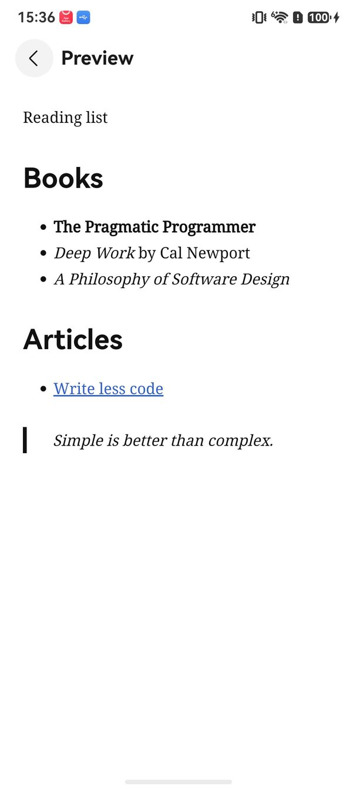
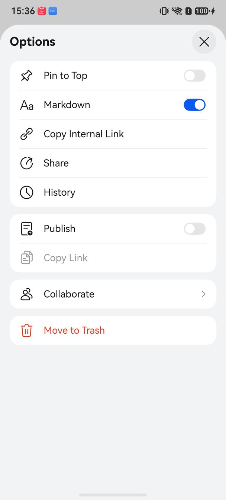

<p align="center"></p>
<h2 align="center"><b>Simplenote</b></h2>
<h4 align="center">The simplest way to keep notes, rebuilt natively for HarmonyOS.</h4>

<p align="center"></p>

> ### Please read this first
>
> This is an unofficial community port. It is not affiliated with, endorsed by, or supported by
> Automattic or the Simplenote iOS project. If something here is broken, it is broken here. Do not
> open an issue upstream for it.
>
> The name Simplenote and the Simplenote logo are trademarks of Automattic Inc. The GPLv2 covers
> the source code, not the name and not the artwork. Both are used here only to say what this is
> a port of, and both will change if Automattic would rather we did not use them.

<p align="center"><a href="#screenshots">Screenshots</a> &bull; <a href="#made-for-harmonyos">Made for HarmonyOS</a> &bull; <a href="#install">Install</a> &bull; <a href="#known-limits">Known limits</a> &bull; <a href="#known-issues">Known issues</a> &bull; <a href="#function-list-comparison">Function list comparison</a> &bull; <a href="#license">License</a></p>

<hr>

Simplenote for iOS is the Simplenote client for iPhone and iPad, written by Automattic and its
contributors. This repository is that app rewritten for HarmonyOS in ArkTS, against ArkUI. It has
the same note list and editor, checklists, Markdown with preview, tags and the tag sidebar,
search, pinning, note history, trash, collaborators, the passcode lock, the home screen widgets,
themes and settings, and it syncs through Simperium as the iOS app does.

Upstream lives at [Automattic/simplenote-ios](https://github.com/Automattic/simplenote-ios).
This port is based on the Simplenote for iOS release 4.55 (build 4.55.0.4) and reports the same
version, `4.55`, on its About screen.
If you are on an iPhone, go there instead. This port exists for people whose phone runs HarmonyOS
and who want the same Simplenote app on it.

## Screenshots

<p align="center">





</p>

The note list with two pinned notes and a published one, a checklist note with a link, a grocery
checklist, the Markdown preview, and the note options. Taken on a Huawei Mate X7 (folded).

## Made for HarmonyOS

The features follow the iOS app, while the screens use the HarmonyOS design: system title bars,
rounded card lists, HarmonyOS symbols and system colours, so the app also follows dark mode and
the system text size. Where iOS has its own services, the port uses HarmonyOS's instead:

- **Editor.** The note is edited in an ArkUI RichEditor: the first line is the title in bold,
  checklist items are real checkboxes you can tick, and links are tinted. The note itself stays
  plain Markdown text, so it syncs unchanged with the other Simplenote apps.
- **Contacts.** Collaborator suggestions come from the contacts you pick in the HarmonyOS contact
  picker (choose "Select all" to offer everyone). The app needs no address-book permission, and it
  remembers your choice across launches, as an iOS contacts grant persists.
- **Shortcuts.** Long-press the app icon for Search, New Note and your most recent note, the
  HarmonyOS counterpart of the iOS Home Screen quick actions.
- **Widgets.** New Note, Note and Note List cards for the HarmonyOS home screen.
- **Links.** Web links in a note, in the Markdown preview and on the sign-in screens open in an
  in-app browser sheet with a Done button, the counterpart of the iOS Safari view.
- **Hardware keyboard.** The iOS keyboard shortcuts work with Ctrl in place of Cmd: Ctrl+N creates
  a note, Ctrl+Shift+F searches, Ctrl+G and Ctrl+Shift+G step through search matches, Ctrl+Shift+P
  toggles the Markdown preview, Ctrl+Return ends editing, and Ctrl+Shift+C (or Cmd+Shift+C on an
  Apple keyboard) inserts a checklist item. The arrow keys, Return and Tab move through the note
  list, the sidebar and the editor, and the passcode screen takes digits from the keyboard.
- **Version.** About shows the version of the iOS release this port is based on, `4.55`.

## Install

There is no prebuilt package here. You build it and sign it yourself, which also means the package
carries your certificate and your device list rather than someone else's.

You need DevEco Studio 6.x with the HarmonyOS SDK 6.1.1 (API 24), a Huawei developer account,
and a phone running HarmonyOS 6.0 or later.

1. Clone this repository and open the folder in DevEco Studio.
2. Go to **File > Project Structure > Signing Configs**. Sign in, connect the device, and let
   DevEco generate a signature. The bundle name is `com.example.myapplication`. If you change it,
   change it in `AppScope/app.json5` and in
   `entry/src/main/resources/base/profile/shortcuts_config.json` as well.
3. Build it: **Build > Build Hap(s)/APP(s) > Build Hap(s)**. The package lands in
   `entry/build/default/outputs/default/`.
4. Install and launch it:

```bash
hdc install -r entry-default-signed.hap
hdc shell aa start -a EntryAbility -b com.example.myapplication
```

A generated debug signature only installs on the devices registered to it, and it expires. When it
does, open the same dialog and generate it again.

The port ships with the public demo Simperium application that the upstream repository uses for
development builds. Log in with an account on that same Simperium application. Regular
simplenote.com accounts do not work with it, exactly as upstream documents for its own development
builds.

## Known limits

What HarmonyOS itself does not offer an app, so the port cannot match iOS here:

- **System search.** Notes do not appear in the HarmonyOS system search, because HarmonyOS has no
  index a third-party app can add its content to. The "Index Notes in Spotlight" setting is kept
  and says so when you turn it on.
- **Recent shortcut.** The Recent app icon shortcut opens your most recent note, but cannot show
  its title as iOS does. HarmonyOS app shortcuts have fixed labels.
- **Sustainer app icon.** HarmonyOS does not let an app change its own icon, so the Sustainer icon
  cannot be switched on.
- **Collaborator suggestions** only include the contacts you picked in the contact picker, not
  your whole address book. Reading the whole address book is a restricted HarmonyOS permission.
  The HarmonyOS picker selects whole contacts, so a contact with several email addresses adds all
  of them. On iOS you pick one address.
- **Cmd shortcuts.** HarmonyOS keeps Cmd+N (notification panel) and Cmd+C (Control Center) for
  itself, so the keyboard shortcuts use Ctrl where iOS uses Cmd: Ctrl+N, Ctrl+Shift+F, Ctrl+G,
  Ctrl+Shift+G, Ctrl+Shift+P and Ctrl+Return.
- **Sharing folders.** HarmonyOS reports a TextBundle (`.textbundle`) as an ordinary folder, so
  Simplenote accepts shared folders in order to import TextBundles. Sharing any other folder also
  offers Simplenote, which then opens an empty share sheet. iOS offers Simplenote for TextBundles
  only.

## Known issues

Open issues that are not HarmonyOS limits:

- **Publishing.** With the demo Simperium application, turning on Publish stays on
  "Publishing..." and Copy Link never becomes available, so the published note's link and the
  "Published" notice cannot be used either. The public link is written by Simplenote's production
  servers, which development builds do not reach. The iOS app built from source behaves the same
  way.
- **Log in with WordPress.com.** WordPress.com rejects the demo credentials ("redirect_uri is
  malformed"). Log in with email instead.
- **Review Your Account.** With the demo Simperium application the account cannot be marked as
  verified, so the Review Your Account screen appears after every login and launch. The iOS app
  built from source does the same. Close it with the cross.
- **Login links from email.** A `https://app.simplenote.com/login...` link opens in the browser,
  not in the app. Opening links in the app needs a production app registered for that domain. The
  `simplenote://login` form of the link works.
- **Rate Us and app reviews.** They need the app to be published on AppGallery. Until then Rate Us
  shows "App no longer available" and the review request shows a notice instead.
- **Siri suggestions.** The "Create a New Note" and "Open <note>" suggestions are not shown. On
  HarmonyOS they would come from Intents Kit, which only accepts an app registered with Huawei under
  its real bundle name. Until then, sharing an intent fails with error 1000101101 ("The application
  has not been registered with the InsightIntent"). Use the app icon shortcuts instead.
- **Siri Shortcuts actions.** Open New Note, Open Note, Append to Note, Create New Note, Find Note,
  Find Note with Tag and Copy Note Content are not implemented yet. HarmonyOS offers app actions to
  the system through Intents Kit (InsightIntent), which is where they would go.
- Phones only. There is no tablet or watch layout.

## Function List Comparison

| Module | Rows | Both | iOS | HarmonyOS |
|---|---:|---:|---:|---:|
| Onboarding and Login | 19 | 19 (100%) | 0 | – |
| Notes List | 21 | 21 (100%) | 0 | – |
| Sidebar | 12 | 12 (100%) | 0 | – |
| Search | 12 | 12 (100%) | 0 | – |
| Note Editor | 15 | 15 (100%) | 0 | – |
| Markdown Preview | 2 | 2 (100%) | 0 | – |
| Tag Editing | 5 | 5 (100%) | 0 | – |
| Note Options | 12 | 12 (100%) | 0 | – |
| Collaborators | 6 | 6 (100%) | 0 | – |
| History | 5 | 5 (100%) | 0 | – |
| Note Info | 5 | 5 (100%) | 0 | – |
| Trash | 4 | 4 (100%) | 0 | – |
| Settings | 17 | 15 (88%) | 2 | – |
| Passcode Lock | 6 | 6 (100%) | 0 | – |
| About | 5 | 5 (100%) | 0 | – |
| Account Verification | 2 | 2 (100%) | 0 | – |
| Share Extension | 5 | 5 (100%) | 0 | – |
| Widgets | 5 | 5 (100%) | 0 | – |
| Siri Shortcuts | 7 | 0 (0%) | 7 | – |
| System Integration | 4 | 3 (75%) | 1 | – |
| Keyboard Shortcuts | 12 | 12 (100%) | 0 | – |
| **Total** | **181** | **171 (94%)** | **10** | **–** |

The full table, one row per function with a note wherever the two apps differ, is in [docs/FUNCTION_LIST_COMPARISON.md](docs/FUNCTION_LIST_COMPARISON.md), and as a workbook with the same grouping as the Function List in [docs/FUNCTION_LIST_COMPARISON.xlsx](docs/FUNCTION_LIST_COMPARISON.xlsx).

## License

GPLv2, the same as upstream. `LICENSE` is the upstream file, unchanged.

Everything written for HarmonyOS is released under those same terms. `NOTICE` lists what came over
from upstream and the services the app talks to at run time.

More about Simplenote: [simplenote.com](https://simplenote.com)
